# CurbOps AI — Agentic Urban Fleet Operations

[](https://github.com/alexgomezz9/curbops-ai/actions/workflows/ci.yml)

**Madrid municipal evidence, agent-led investigation and street-route planning in one workspace.**

Built by [Álex Gómez](https://github.com/alexgomezz9).

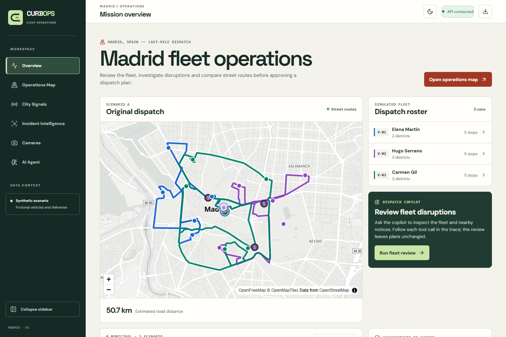

Urban fleet decisions start with scattered information: a roadworks notice, a congested sensor, a camera image and a delivery route. CurbOps connects those pieces on a map. Ask the copilot to investigate, inspect the tools it actually ran, prepare a route proposal and compare the result before approving it.

**Observe → investigate → prepare → compare → approve.**

[Explore the application](#inside-curbops) · [Agent tools](#22-tools-one-copilot) · [Architecture](#architecture) · [Run locally](#run-locally)

## Inside CurbOps

### Operations Map — work directly with the city

A Madrid street map and a free-form copilot share the workspace. Select a van, inspect its stops and nearby evidence, switch A/B/C scenarios, control map layers or ask the agent to focus the map for you. Fullscreen keeps both the map and the conversation visible.

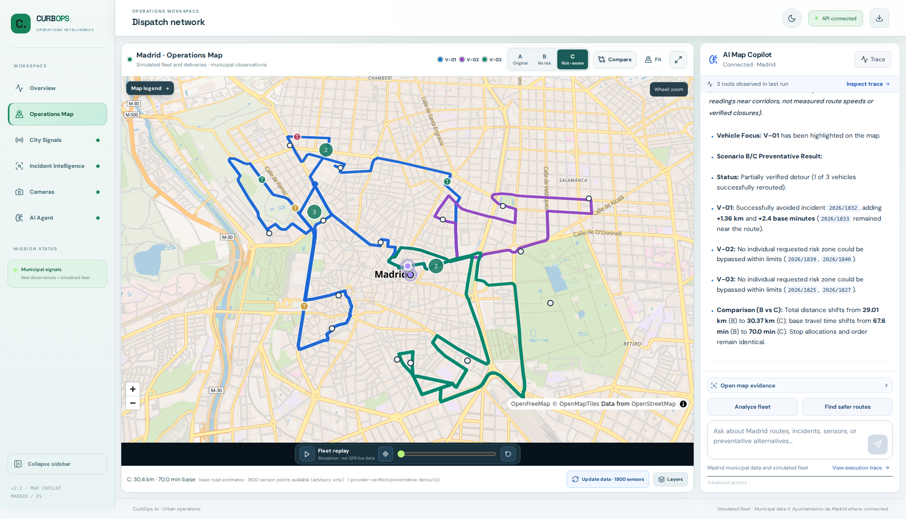

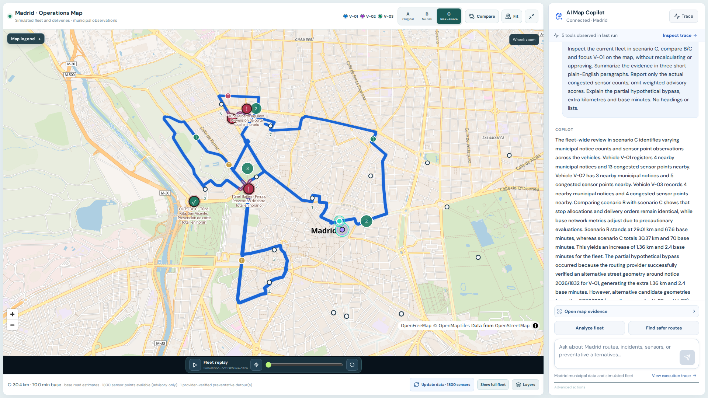

### City Signals — explore municipal observations

Inspect sampled traffic measurements, service-level distributions, sensor locations and source health. Downloads are opt-in; timestamps and coverage stay visible. A second successful snapshot enables a comparison of the same sensors over time.

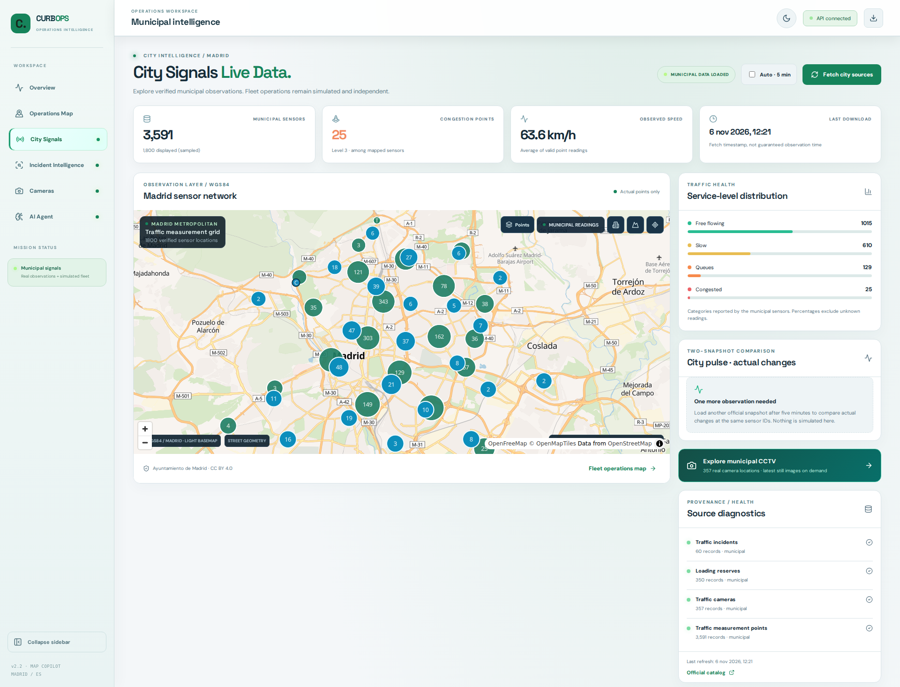

### Cameras — inspect the street context

Search Madrid's municipal camera catalogue, select a location and open its latest available periodic still. The image is fetched through a backend proxy restricted to published municipal sources.

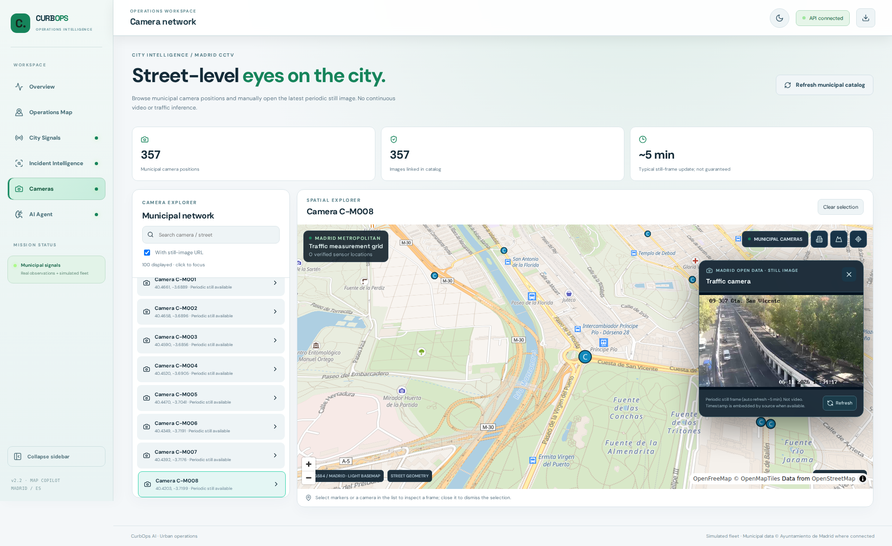

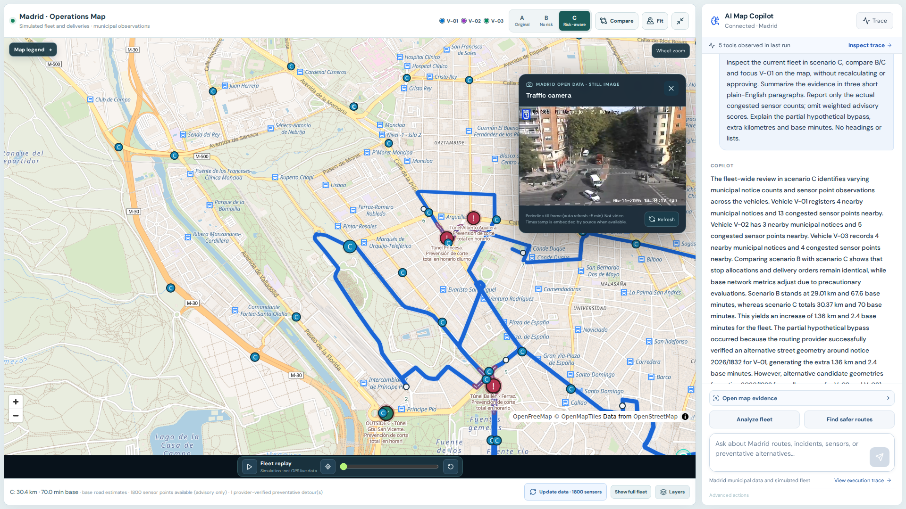

### Incident Intelligence — connect a notice to nearby evidence

Open a municipal notice and inspect geographically nearby sensors, cameras and loading reserves. The map preserves the notice's source and details; the investigation leaves existing plans unchanged.

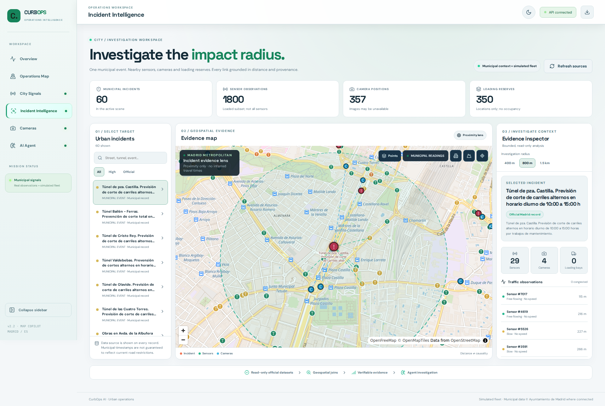

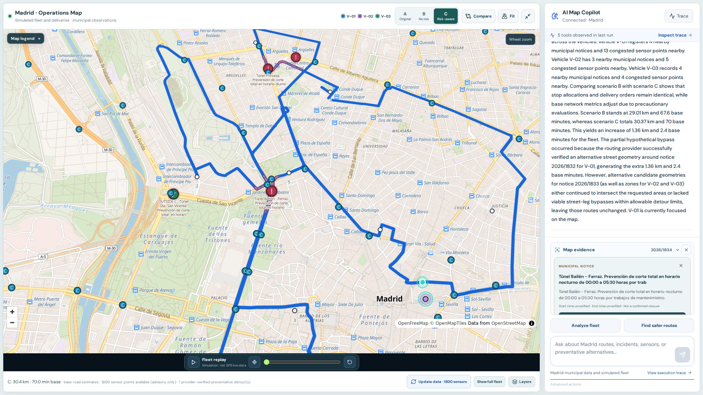

### Route comparison — inspect what changed

Compare original assignment **A**, road-cost optimization **B** and risk-aware candidate **C** using the same routing fidelity. Focus one vehicle, inspect the reference and candidate geometries, and review distance, base driving time and stop allocation.

An explicit preventative-bypass request asks the provider for alternative street geometry and checks hypothetical notice buffers, required stops and detour budgets. Each vehicle gets an outcome; unsuccessful alternatives remain visible.

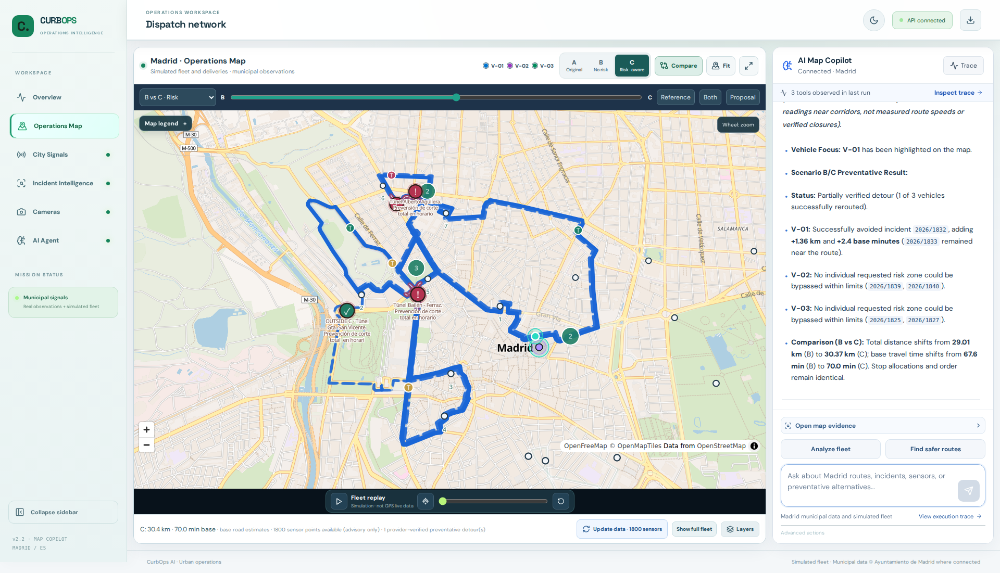

### AI Agent — follow every executed tool

The agent workspace combines free-form requests, an operational briefing, model-call telemetry and an execution timeline. Open individual tool outputs or expand the workflow graph to inspect the complete tool catalogue. Executed and uncalled tools have distinct states.

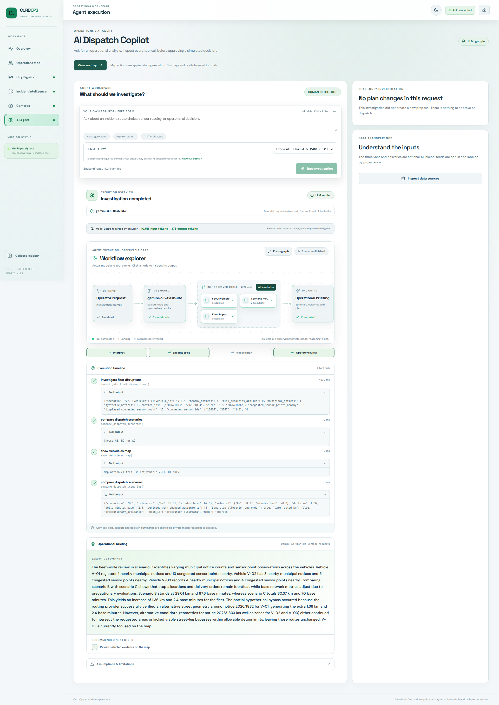

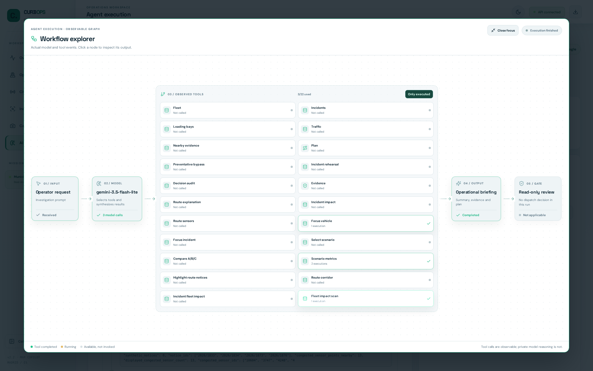

All screenshots come from the running application in the light theme. The fleet and delivery orders are synthetic. Municipal observations retain their source and download information.

## 22 tools, one copilot

The model selects typed, allowlisted tools. Python services perform the calculations, road providers return street geometry, and SSE events carry the observed actions and results into the UI. The agent can prepare a proposal; approval belongs to the operator.

### Read the city and the fleet

| Tool | What it does |
|---|---|
| `inspect_fleet` | Reads the fictional vehicles, deliveries and original assignment. |
| `get_active_incidents` | Lists mapped notices with their origin and severity. |
| `inspect_loading_reserves` | Reads loading-zone inventory and locations. |
| `inspect_traffic_measurements` | Summarizes loaded municipal point measurements and coverage. |
| `inspect_incident_evidence` | Finds sensors, cameras and loading reserves near a notice. |
| `inspect_data_provenance` | Reports source origin, record counts and available timestamps. |
| `inspect_vehicle_corridor` | Inspects notices along a vehicle's road polyline and their temporal status. |
| `inspect_incident_fleet_corridor` | Finds fleet routes near a selected notice. |
| `inspect_route_traffic_measurements` | Reads sampled sensor observations near a vehicle's street route. |
| `investigate_fleet_disruptions` | Runs a read-only fleet review and prepares map focus/highlights. |

### Prepare and explain routes

| Tool | What it does |
|---|---|
| `prepare_dispatch_proposal` | Prepares an unapproved road-based delivery assignment and visit order. |
| `prepare_precautionary_avoidance` | Searches for provider-backed hypothetical bypasses for one van or the whole fleet. |
| `rehearse_incident_response` | Creates an explicitly requested synthetic obstacle rehearsal and prepares B/C. |
| `inspect_dispatch_decision` | Audits the objective, stop moves and incident-proximity counterfactual. |
| `inspect_vehicle_decision` | Explains a vehicle's A/B/C allocation, road legs and evidence. |
| `inspect_incident_route_impact` | Inspects street legs near one notice and its modelled counterfactual. |
| `compare_dispatch_scenarios` | Compares A/B, B/C or A/C metrics and stop assignments without recalculation. |

### Act on the map

| Tool | What it does |
|---|---|
| `show_vehicle_on_map` | Selects and focuses a vehicle. |
| `show_incident_on_map` | Selects and focuses a notice. |
| `show_scenario_on_map` | Switches the displayed A/B/C scenario. |
| `show_comparison_on_map` | Opens a compatible scenario comparison. |
| `highlight_vehicle_incidents_on_map` | Highlights geographically nearby notices along a selected route. |

### Agent execution and LangGraph

LangChain's `create_agent` provides the model/tool loop using LangGraph internally. A separate deterministic fleet-review graph performs **inspect road corridors → prioritize evidence → prepare map actions**. The trace shows completed node events, tool outputs and model usage when supplied by the provider.

Browser conversation history is bounded and passed explicitly with the current map context. Backend state is authoritative for proposals and approvals. Gemini and Groq are supported; without model credentials, the labelled deterministic demo engine exercises local tools. [Evaluation cases](docs/evaluation.md)

## Routing and A/B/C

The optimizer uses a provider road-time/distance matrix and bounded best-improvement stop moves, enforcing capacity and exactly-once delivery assignment. C ranks a bounded set of candidates using time-eligible notice proximity on road polylines. Failed matrix or route requests do not publish a straight-line fallback.

| Scenario | Meaning |
|---|---|
| **A — original** | The fictional fleet's original delivery allocation, routed on streets once loaded. |
| **B — road-cost optimized** | Assignment and stop order optimized without incident penalties. |
| **C — risk-aware** | Candidate ranked with approximate incident proximity, or an explicitly requested preventative alternative. |

Three synthetic vans serve 15 synthetic orders. One run on **6 November 2026** produced the following modelled results using OSRM roads and a downloaded Madrid snapshot:

| Scenario | Road distance | Base driving time | Stops |
|---|---:|---:|---:|
| A | 50.65 km | 113.5 min | 15 |
| B | 29.01 km | 67.6 min | 15 |
| Initial C | 29.01 km | 67.6 min | 15 |
| C after a preventative request | 30.37 km | 70.0 min | 15 |

B and initial C were identical. The later request accepted one **partial hypothetical bypass for V-01**, adding 1.36 km and 2.4 base minutes; V-02/V-03 stayed unchanged. Some notice buffers remained unresolved. These are modelled scenario outcomes, not observed business savings or a globally optimal solution. [Recorded checks and outcomes](docs/verification.md)

OSRM is the default noncommercial demo provider; ORS is optional. [Provider usage and budgets](docs/API_BUDGET.md)

## Architecture


**Frontend:** Next.js 15 · React 19 · TypeScript · MapLibre GL JS 6

**Backend:** Python · FastAPI · Pydantic · HTTPX · LangChain · LangGraph

**Services:** Madrid Open Data · OpenFreeMap / OpenStreetMap · OSRM / ORS · Gemini / Groq

**Runtime:** Docker Compose · single-user in-memory state

[Architecture details](docs/architecture.md)

## Run locally

Requirements: Docker with Compose v2.24 or later, and free local ports 3000 and 8000. Network access is needed to build the images and for street tiles, routing and municipal feeds.

```bash
git clone https://github.com/alexgomezz9/curbops-ai.git
cd curbops-ai
make demo
```

Open **http://localhost:3000**. The demo starts with a simulated fleet and needs no keys or `.env` file. `make demo` waits for both services, then checks the web entry point and three read-only API endpoints.

1. Select **Load street routes** to calculate the original dispatch (A).
2. Open the **Operations Map** and choose **Advanced actions → Recalculate with road engine (no LLM)** to prepare B/C.
3. Use **Fetch Madrid data** to download municipal feeds, or **Run fleet review** to see a read-only investigation and its tool trace.

```bash
make status    # List the two services
make logs      # Recent service output
make smoke     # Check a running demo
make down      # Stop the stack
```

On Windows without GNU Make, run `docker compose up --build --wait` and `docker compose down` directly. The Compose ports are bound to loopback for a local, single-user demo. [Operator guide](docs/demo.md)

### Connect Gemini

For model or routing credentials, create a private `.env` at the repository root using `.env.example` as a reference. Keep any existing file. For Gemini:

```dotenv
AGENT_PROVIDER=google
GOOGLE_API_KEY=your_key_here
GEMINI_MODEL=your_available_gemini_model
```

```bash
docker compose up -d --force-recreate api
```

Use a model available to your project. Groq is an alternative through `AGENT_PROVIDER=groq`, `GROQ_API_KEY` and `GROQ_MODEL`. ORS uses `ROUTING_PROVIDER=ors` and `ORS_API_KEY`; the default is `ROUTING_PROVIDER=osrm_demo`. Credentials stay on the backend.

### Verify

With Python 3.12 and Node.js 22, install `backend/requirements-dev.txt` in an activated virtual environment and run `npm ci` in `frontend/`, then:

```bash
make verify
```

The backend tests mock outbound providers. CI also builds the Compose demo and checks its entry points. For a native API instance, run `python scripts/smoke.py --web-url http://localhost:3000`. [Verification record](docs/verification.md)

## Data and operating boundaries

- Vehicles, orders, rehearsal obstacles and approval decisions are **synthetic**.
- Municipal point notices describe geographic context; they do not establish confirmed closed road segments.
- Sensor readings describe sampled points. They do not provide live route ETAs or complete city coverage.
- Camera images are periodic stills; loading reserves are an inventory without real-time occupancy.
- The agent cannot approve or dispatch. Approval requires a matching, non-stale pending proposal.
- State is single-user and in memory. Public multi-user use requires authentication, isolated state and durable audit.

Municipal data: **Ayuntamiento de Madrid**. Map data: **© OpenStreetMap contributors**, ODbL; tiles/styles via OpenFreeMap. Camera stills and map screenshots retain their source attribution. [Data catalogue](docs/data-sources.md) · [Third-party notices](docs/third-party-notices.md)

## Rights

**Copyright © 2026 CurbOps AI contributors. All rights reserved.**

Source code is publicly available for inspection. No license is granted for reproduction, modification, redistribution, or commercial use except as permitted by applicable law. Third-party components and data retain their own licences.
