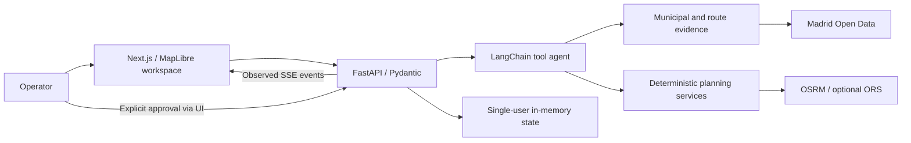

# CurbOps AI — Agentic Urban Fleet Operations

[](https://github.com/alexgomezz9/curbops-ai/actions/workflows/ci.yml)

**Investigate a city disruption, inspect the evidence, compare street-route proposals and keep the decision with the operator.**


[Watch the desktop demo](media/curbops-demo.mp4) · [Reproduce the walkthrough](docs/demo.md)

Urban delivery decisions involve scattered notices, sensor readings, routes and uncertain restrictions. CurbOps brings them into one map-and-copilot workspace. A tool-calling agent gathers evidence; deterministic services calculate routes; a human reviews the proposal.

- **Watch the agent work:** observed tool calls and SSE events update the map and execution trace.
- **Compare defensible alternatives:** provider street geometries, explicit A/B/C scenarios and bounded hypothetical bypass checks.
- **Know what the numbers mean:** real municipal observations when fetched, a synthetic fleet, and base road estimates rather than live traffic ETAs.

A portfolio MVP for Forward Deployed Engineering, AI Engineering and Software Engineering. It is a local, single-user prototype, not a production dispatch service.

## What works

| Capability | Implementation |
|---|---|
| Map copilot | Free-form chat, vehicle/scenario focus, layer controls and fullscreen map + chat |
| Municipal evidence | Madrid incidents, sampled traffic sensors, camera stills and loading-zone inventory with provenance |
| Agent orchestration | Gemini/Groq through LangChain `create_agent`; allowlisted tools and observed execution telemetry |
| Fleet investigation | Read-only road-corridor inspection and a three-step deterministic LangGraph workflow |
| Route preparation | Provider road-cost matrix, capacity-constrained local search and atomic proposal updates |
| Preventative bypasses | Explicit operator request; provider-returned geometry checked against hypothetical buffers and detour budgets |
| Human review | Matching, non-stale pending proposal required; the agent cannot approve or dispatch |

## A reproducible synthetic fleet

Three fictional vans serve 15 fictional delivery orders in Madrid. An observed run on **6 November 2026**, using OSRM road costs and the downloaded municipal snapshot, produced:

| Scenario | Road distance | Base driving time | Delivery stops |
|---|---:|---:|---:|
| **A — original assignment** | 50.65 km | 113.5 min | 15 |
| **B — road-cost optimization** | 29.01 km | 67.6 min | 15 |
| **C — risk-aware candidate** | 29.01 km | 67.6 min | 15 |

These are **modelled scenario results**, not observed operational savings. B and C were identical in this run: the municipal proximity penalties did not change the chosen candidate. The solver is a bounded heuristic, not a proof of global optimality. Provider responses and source snapshots can change subsequent results.

A separate preventative-avoidance request can replace C with verified hypothetical bypasses. A returned road path must pass the geometry, required-stop and detour-budget checks; a failed search remains a failure. See the [verification record](docs/verification.md) for actual outcomes and limitations.

## Architecture



**Stack:** Next.js 15, React 19, TypeScript, MapLibre GL JS 6, Python, FastAPI, Pydantic, LangChain, LangGraph, HTTPX and Docker Compose.

The browser holds bounded conversation history and sends current map context explicitly. The backend keeps the authoritative scenario and approval state. There is no durable database or multi-user memory. [Architecture details →](docs/architecture.md)

### Agent, tools and LangGraph

The model chooses typed tools for evidence lookup, route inspection, proposal preparation and allowlisted map actions. Python performs the calculations; the model does not draw roads or approve plans.

LangChain's `create_agent` provides the model/tool loop using LangGraph internally. A separate small, deterministic fleet-review graph executes **inspect road corridors → prioritize evidence → prepare map actions**. Its node events describe completed operations, not private model reasoning.

Without model credentials, the explicitly labelled deterministic demo engine exercises local scenario tools. It is not described as an LLM. [Evaluation cases →](docs/evaluation.md)

### Routing and A/B/C

The optimizer uses a road-provider time/distance matrix and bounded best-improvement stop moves, enforcing capacity and exactly-once delivery assignment. C ranks a bounded set of candidates using time-eligible incident proximity evaluated on provider road polylines. Matrix or route failures do not publish a straight-line fallback.

- **A:** original fictional allocation, with street geometry once loaded.
- **B:** road-cost optimization without incident penalties.
- **C:** risk-aware candidate, or an explicitly requested hypothetical preventative alternative.

OSRM is the default noncommercial demo provider. ORS is optional and requires a backend key. Neither integration turns a municipal point into a certified closed road or a sensor reading into a live route ETA. [Provider usage and budgets →](docs/API_BUDGET.md)

## Quick start

Requirements: Docker Engine with Compose v2, available ports 3000/8000, and network access for image builds, map tiles and optional road routing.

```bash
git clone https://github.com/alexgomezz9/curbops-ai.git
cd curbops-ai
cp .env.example .env
docker compose up --build -d
```

Open **http://localhost:3000**. Switch to the light theme, load the original road routes, and use **Advanced actions → Recalculate with road engine (no LLM)** to prepare B/C without model credentials. **Load city data** is an explicit opt-in download.

```bash
./scripts/smoke.sh       # read-only API checks
# Stop this project's containers when finished:
docker compose down
```

The supplied Compose file publishes ports on the host. Run it on a trusted development machine; do not expose its unauthenticated API publicly. See [the demo walkthrough](docs/demo.md) for the full operator sequence.

### Optional Gemini configuration

Edit the untracked `.env`, then recreate the API:

```dotenv
AGENT_PROVIDER=google
GOOGLE_API_KEY=your_key_here
GEMINI_MODEL=your_available_gemini_model
```

```bash
docker compose up -d --force-recreate api
```

Choose a model available to your project; provider access, quotas and billing vary. `python -m app.agents.check_models` inside the API container can list available Gemini models without printing the key. Groq is an alternative through `AGENT_PROVIDER=groq`, `GROQ_API_KEY` and `GROQ_MODEL`.

Road routing uses `ROUTING_PROVIDER=osrm_demo` by default. To use ORS, configure `ROUTING_PROVIDER=ors` and `ORS_API_KEY`. Keys remain on the backend and are not included in screenshots or exported frontend configuration.

## Screenshots

Actual desktop captures in the light theme. The fleet is simulated; municipal notices retain their published source text.

| Operations map | Incident investigation |
|---|---|
|  |  |

| Route comparison | Agent observability |
|---|---|
|  |  |

## Verification and limits

Run the local automated checks after installing the backend development requirements and `npm ci` in `frontend/`:

```bash
./scripts/verify.sh
```

Backend tests mock external providers; TypeScript and build checks do not establish live integration correctness. The [verification record](docs/verification.md) separates automated, browser and live-provider evidence, including dependency audit results.

- Municipal point notices are **not confirmed road closures**. Unknown-time notices remain geographic context.
- Sensor points are a sampled observation layer, not complete city coverage, route-delay predictions or live ETAs.
- Camera images are periodic stills. No video analysis or computer vision is implemented.
- Loading zones are an inventory, not real-time availability.
- All vehicles, orders, rehearsal obstacles and dispatch decisions are synthetic.
- State is global and in memory. Authentication, durable audit, multi-tenant isolation and public request budgets are outside this MVP.

## Sources and rights

Municipal data: **Ayuntamiento de Madrid**, under the applicable dataset terms. Map data: **© OpenStreetMap contributors**, ODbL; tiles/styles via OpenFreeMap. Retain attribution when sharing screenshots. [Data catalogue](docs/data-sources.md) · [Third-party notices and service terms](docs/third-party-notices.md).

**Copyright © 2026 CurbOps AI contributors. All rights reserved.**

Source code is publicly available for inspection. No license is granted for reproduction, modification, redistribution, or commercial use except as permitted by applicable law.

Earlier revisions were published with an MIT licence; removing the current `LICENSE` file does not revoke permissions already granted for those revisions. Third-party components and data retain their own licences. GitHub's applicable terms for viewing and forking public repositories continue to apply.
