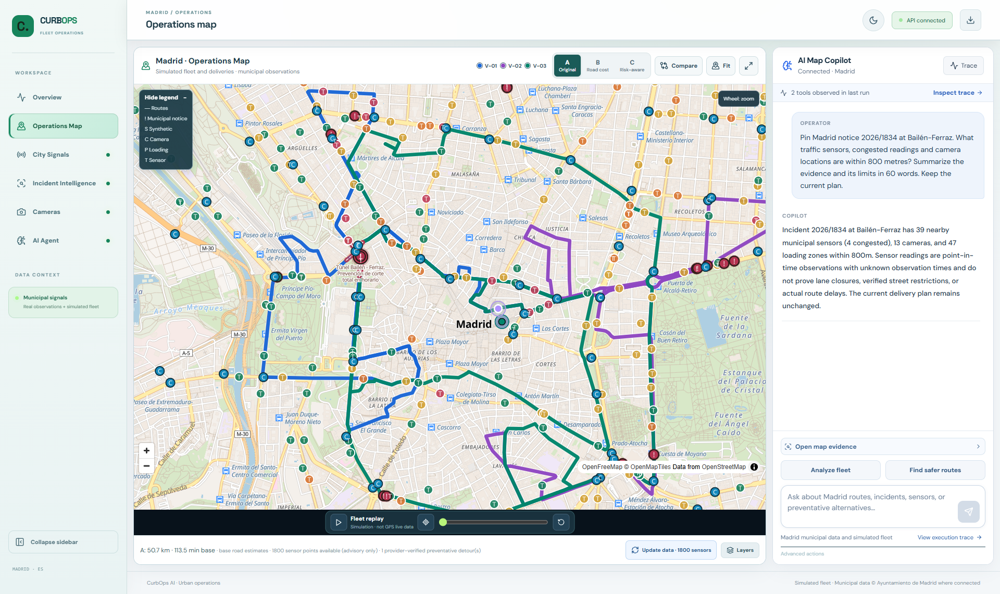

# CurbOps AI | Agentic Urban Fleet Operations

**An agentic AI workspace for urban fleet operations. Ask about a Madrid road notice, inspect nearby traffic and cameras, and compare street routes before approving a simulated dispatch.**

LangChain · LangGraph · FastAPI · Next.js · MapLibre · OSRM

[Run the demo](#run-locally) · [See an agent investigation](#investigate-madrid-with-the-copilot) · [Compare routes](#routing-and-abc) · [Architecture](#architecture) · [Verification](docs/verification.md) · [Álex Gómez](https://github.com/alexgomezz9)

## Investigate Madrid with the copilot

Ask about a municipal roadworks notice in plain language. The copilot checks nearby traffic sensors and camera locations, then pins the notice on the map so the operator can inspect the evidence in context.

In this recorded Gemini run, the agent inspected notice **2026/1834** and focused it on the map. Within 800 m, the loaded municipal snapshot contained **39 traffic sensors**, including **4 reporting congestion**, and **13 camera locations**. The tool trace recorded the evidence lookup and map action. The dispatch plan stayed at the same generation.

### Incident evidence and nearby traffic readings

### Municipal cameras

## Inside CurbOps

1. **Investigate.** Select a Madrid road notice and find nearby municipal sensors, camera stills and loading zones. The evidence panel keeps the source, distance and available timestamps visible.
2. **Prepare.** Ask the copilot for a route proposal or run the deterministic road engine directly. The planner uses road-network costs, vehicle capacity and exactly-once delivery assignment.
3. **Compare.** Overlay the reference and candidate routes for the fleet or one van. Inspect distance, base driving time and stop allocation before accepting a trade-off.
4. **Review.** Inspect the executed tools and their outputs in the trace. The operator approves a specific, current proposal through a separate API action.

<strong>Explore more screens</strong>

### Operations Map

### City Signals

### Camera on the map

[Fullscreen copilot](media/screenshots/06-fullscreen-copilot.png) · [Notice on the map](media/screenshots/10-map-incident.png)

## Agentic AI and tool observability

LangChain's `create_agent`, backed by LangGraph, runs the LLM tool-calling loop. A separate deterministic LangGraph workflow inspects fleet corridors, prioritizes evidence and prepares map actions. FastAPI streams observed tool and graph events over **Server-Sent Events (SSE)** so an operator can follow what the system actually ran.

The execution trace exposes individual tool outputs and model usage when the provider reports it. The backend owns proposal state and checks plan identity and freshness when an operator approves a plan. [Evaluation cases](docs/evaluation.md) · [Release verification](docs/verification.md)

## Routing and A/B/C

The road engine builds an OSRM time and distance matrix, then searches a bounded set of stop moves and visit orders. **A** preserves the original dispatch. **B** optimizes road cost. **C** accounts for eligible notice proximity or evaluates a specifically requested hypothetical bypass. The comparison uses street geometry in each scenario.

One recorded OSRM run on **6 November 2026** reduced modelled road distance from **50.65 km to 29.01 km** while keeping all 15 stops. A subsequent request accepted a partial hypothetical bypass for V-01 with an additional **1.36 km and 2.4 base minutes**. The other two vans kept their routes.

The application checked provider-returned geometry against required stops, notice buffers and detour budgets. Some buffers remained unresolved. Distances and times are modelled results for a synthetic fleet. [Recorded scenario results](docs/verification.md) · [Routing provider budgets](docs/API_BUDGET.md)

## Architecture

~~~mermaid
flowchart LR
    Operator[Dispatch operator] --> UI[Next.js and MapLibre]
    UI --> API[FastAPI and Pydantic]
    API --> Agent["LangGraph runtime · LangChain create_agent"]
    API --> Demo[Deterministic no-key demo]
    Agent --> Tools[Typed investigation and planning tools]
    Tools --> Evidence["Geospatial evidence · Madrid Open Data"]
    Tools --> FleetGraph[Deterministic LangGraph fleet review]
    FleetGraph --> Evidence
    Tools --> Planner[Deterministic route planner]
    Planner --> Roads[OSRM or ORS]
    API --> State[Scenario and proposal state]
    API -->|Tool events and map actions via SSE| UI
    UI -->|Explicit operator approval| API
~~~

[Architecture details](docs/architecture.md) · [Agent runner](backend/app/agents/runner.py) · [Fleet review graph](backend/app/services/fleet_review_graph.py) · [Road planner](backend/app/services/road_plans.py)

## Run locally

Install Docker with Compose v2.24 or later and free local ports 3000 and 8000. The demo starts with a synthetic fleet and works without model credentials or an `.env` file. Street tiles, routing and municipal feeds use network access.

~~~bash
git clone https://github.com/alexgomezz9/curbops-ai.git
cd curbops-ai
make demo
~~~

Open [localhost:3000](http://localhost:3000). Choose **Fetch Madrid data** to load municipal evidence or **Run fleet review** to see the local tool trace. To compare routes, load scenario A with **Load street routes**, then choose **Advanced actions → Recalculate with road engine (no LLM)** in Operations Map. Connect Gemini or Groq to reproduce the natural-language investigation above.

~~~bash
make smoke     # Check the running web and API
make down      # Stop the stack
~~~

On Windows without GNU Make, use `docker compose up --build --wait` and `docker compose down`. [Operator guide](docs/demo.md)

<strong>Connect a model or run the test suite</strong>

Set `AGENT_PROVIDER=google`, `GOOGLE_API_KEY` and `GEMINI_MODEL` in a private root `.env`, using [the template](.env.example) for reference. For Groq, set `AGENT_PROVIDER=groq`, `GROQ_API_KEY` and `GROQ_MODEL`. For ORS routing, set `ROUTING_PROVIDER=ors` and `ORS_API_KEY`. Apply backend environment changes with `docker compose up -d --force-recreate api`.

With Python 3.12 and Node.js 22, activate a Python virtual environment and run these commands from the repository root.

~~~bash
python -m pip install -r backend/requirements-dev.txt
npm --prefix frontend ci
make verify
~~~

CI runs the backend tests, TypeScript checks, production build and Compose smoke checks. [Verification record](docs/verification.md)

## Data and operating boundaries

The fleet, orders, rehearsals and dispatch approvals are synthetic. Municipal road notices describe geographic proximity. Sensor readings are point observations. Camera images are periodic stills and loading zones are an inventory. Public multi-user deployment would require authentication, isolated state and durable audit records.

Municipal data comes from **Ayuntamiento de Madrid**. Map data is **© OpenStreetMap contributors**, ODbL, with tiles and styles via OpenFreeMap. [Data catalogue](docs/data-sources.md) · [Third-party notices](docs/third-party-notices.md)

## Rights

**Copyright © 2026 CurbOps AI contributors. All rights reserved.**

Source code is publicly available for inspection. No license is granted for reproduction, modification, redistribution, or commercial use except as permitted by applicable law. Third-party components and data retain their own licences.
