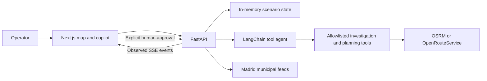

# Architecture

CurbOps is a single-user urban operations prototype. Its main workflow is incident investigation, route preparation, comparison and human review. The delivery fleet and business outcomes are synthetic.

## Frontend

Next.js, React and TypeScript provide the workspace; MapLibre renders the city map. Operations Map contains the map and conversation. Municipal signals, incident evidence, camera stills and the execution trace have dedicated views. The browser receives typed map commands and observed tool events through SSE.

Credentials stay on the backend. The frontend's public API URL is configuration, not a credential. A bundled synthetic snapshot supports read-only preview when the API is unavailable.

## Backend and state

FastAPI exposes typed Pydantic contracts. A shared in-memory store holds the fictional fleet, municipal observations and current plans. Proposal updates check scenario generation and incident freshness before committing a result. Human approval requires a matching, current plan ID.

This is not a multi-tenant service: there is no durable database, authentication or isolated user state. A production deployment would need those boundaries and request budgets before exposing write endpoints.

## Agent execution

The real model path uses LangChain's `create_agent`, backed by LangGraph. The model selects permitted tools; Python services perform geographic joins and route calculations. The agent has no approval or dispatch tool. SSE reports observed model/tool events and map actions, not private model reasoning.

Whole-fleet screening also has a small deterministic LangGraph workflow: inspect road corridors, prioritize observed evidence, and prepare read-only map actions. These nodes report completed work, not model reasoning, and do not change plans.

Without provider credentials, an explicitly labelled deterministic demo engine is available. It is not represented as an LLM. Model errors remain errors rather than silently switching to a fabricated successful execution.

## Route scenarios

- **A:** original fictional assignments, with road geometry when loaded.
- **B:** road-cost optimization without incident penalties.
- **C:** a bounded risk-aware proposal or an explicitly requested hypothetical avoidance alternative.

Comparable road metrics use the same provider fidelity. Matrix/provider failures do not fall back to straight-line planning costs. Hypothetical avoidance accepts only provider-returned geometries satisfying the configured buffers and detour budget.

A municipal incident point is spatial evidence, not a validated blocked road edge. Sensor readings do not supply live routing costs or delivery ETAs. Route differences describe the synthetic planning model, not observed business savings.

## External data boundaries

Municipal ingestion is opt-in and subject to backend cooldown. Camera URLs come from the configured catalogue; the image proxy validates hosts, size and content. Clients cannot submit arbitrary fetch URLs. Loading bays are inventories, not occupancy observations. See [data sources](data-sources.md) and [provider usage](API_BUDGET.md).

## Verification

Backend tests mock outbound providers. They verify local contracts and failure handling, not the availability or accuracy of live municipal data or external routing. TypeScript and production builds check frontend compilation; browser interaction requires separate verification.
